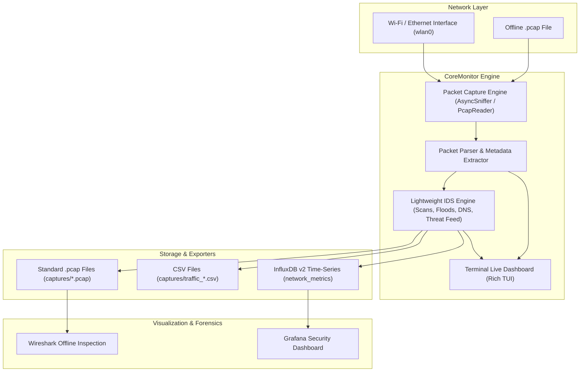

# CoreMonitor 🛡️

**CoreMonitor** is a lightweight Network Traffic Analyzer and Intrusion Detection System (IDS) designed to act as a proactive security guard for your local network. It sniffs live network packets across Wi-Fi or Ethernet interfaces, extracts deep packet metadata, identifies malicious behavior and traffic anomalies in real time, and exports metrics for visual dashboarding in Grafana and deep offline inspection in Wireshark.

---

## 🌟 Key Features

1. **Live Network Packet Sniffing & Filtering**
   - High-performance asynchronous sniffing using Scapy over active interfaces (e.g. `wlan0`, `eth0`, `any`).
   - Supports custom Berkeley Packet Filters (BPF) like `"tcp and port not 22"`.

2. **Lightweight Rule-Based & Behavioral IDS Engine**
   - **Port Scan Detection**: Detects TCP SYN scans probing multiple distinct ports within a configurable sliding window.
   - **Stealth Scans**: Flags abnormal flag combinations such as Xmas scans (`FIN+PSH+URG`), Null scans (no flags), and FIN scans.
   - **Flood & DoS Alerts**: Triggers on TCP SYN floods, ICMP ping floods, and anomalous bandwidth spikes (MB/s thresholds).
   - **Insecure / Suspicious Services**: Alerts on cleartext protocol exposures (Telnet port 23, FTP port 21) and known attacker listener ports (Metasploit default port 4444, Back Orifice 31337, etc.).
   - **DNS Tunneling & Exfiltration Anomaly**: Flags abnormally long DNS queries indicative of covert channels.
   - **Threat Intelligence & Blacklist**: Matches inbound and outbound traffic against known malicious IP feeds.
   - **Anti-Alert Storm Cooldown**: Intelligently suppresses repetitive alerts from the same source.

3. **Storage & Multi-Format Exporters**
   - **PCAP Exporter**: Automatically saves raw network packets into standard `.pcap` files with automated time/size rotation for offline inspection in Wireshark.
   - **CSV Exporter**: Streams parsed packet metadata and detected security alerts into organized CSV logs.
   - **InfluxDB Time-Series Exporter**: Asynchronously batches packet metrics, bandwidth stats, DNS logs, and IDS alerts into InfluxDB v2 with non-blocking fail-safe buffering.

4. **Interactive Terminal TUI & Grafana Visualization**
   - **Rich Terminal UI**: Live dashboard showing real-time throughput (KB/s, pkts/s), top active talkers, protocol distribution, recent packet log, and security alerts.
   - **Pre-Provisioned Grafana Dashboard**: Ready-to-go dashboard featuring bandwidth graphs, protocol donut charts, top talkers, DNS query activity, and real-time security alert logs.

---

## 🏗️ Architecture



---

## 🚀 Quick Start

### 1. Installation

Clone the repository and set up a Python virtual environment:

```bash
git clone https://github.com/deepak-pandey2005/CoreMonitor.git
cd CoreMonitor

python3 -m venv .venv
source .venv/bin/activate
pip install -r requirements.txt
```

### 2. Network Capture Permissions (Linux)

Packet capture on raw sockets requires either root privileges or the `CAP_NET_RAW` capability:

```bash
# Option A: Grant network capabilities to virtual environment (recommended, no sudo needed thereafter)
sudo ./scripts/setup_permissions.sh

# Option B: Run commands with sudo
sudo .venv/bin/python -m coremonitor live -i wlan0
```

---

## 💻 Usage

### Live Network Capture & IDS (Interactive Terminal TUI)

Start capturing traffic from your Wi-Fi interface (`wlan0`):

```bash
.venv/bin/python -m coremonitor live -i wlan0
```

To run in headless / background mode (without the interactive TUI):
```bash
.venv/bin/python -m coremonitor live -i wlan0 --no-tui
```

Apply a BPF filter (e.g. monitor only HTTP/HTTPS traffic):
```bash
.venv/bin/python -m coremonitor live -i wlan0 --bpf "tcp port 80 or tcp port 443"
```

### Offline PCAP Inspection

Deeply inspect an existing `.pcap` capture file without needing root privileges:

```bash
.venv/bin/python -m coremonitor pcap tests/data/sample.pcap --no-influx
```

### Simulate Traffic & Security Scenarios

CoreMonitor includes a built-in traffic generator that synthesizes normal web requests alongside simulated attacks (SYN port scans, Xmas scans, Null scans, Telnet exposures, Metasploit listeners, DNS tunneling anomalies, and ICMP floods):

```bash
.venv/bin/python scripts/simulate_traffic.py -o captures/sample_attack.pcap
.venv/bin/python -m coremonitor pcap captures/sample_attack.pcap --no-influx
```

---

## 📊 InfluxDB & Grafana Setup

CoreMonitor supports both standalone host setups and one-command Docker Compose deployment:

### Launch Database & Dashboard with Docker Compose:
```bash
docker compose up -d
```

This starts:
- **InfluxDB v2** on `http://localhost:8086` (pre-configured with organization `coremonitor-org` and bucket `network_metrics`).
- **Grafana** on `http://localhost:3000` (credentials: `admin` / `admin`).
  - Pre-provisioned InfluxDB datasource.
  - Automatically imported **CoreMonitor Network Security & Bandwidth Dashboard**.

### Run CoreMonitor with InfluxDB Export Enabled:
```bash
.venv/bin/python -m coremonitor live -i wlan0
```

---

## ⚙️ Configuration (`config.yaml`)

Edit [`config.yaml`](file:///home/deepak/OPENSOURCE/CoreMonitor/config.yaml) to tune capture parameters and detection thresholds:

```yaml
network:
  interface: "wlan0"
  bpf_filter: ""
  promiscuous: true

storage:
  pcap_enabled: true
  pcap_dir: "captures"
  pcap_rotate_seconds: 3600
  csv_enabled: true
  csv_dir: "captures"

influxdb:
  enabled: true
  url: "http://localhost:8086"
  token: "coremonitor-super-secret-auth-token"
  org: "coremonitor-org"
  bucket: "network_metrics"

ids:
  enabled: true
  port_scan_threshold: 15       # Ports probed within window to trigger alert
  port_scan_window_seconds: 10
  syn_flood_threshold: 100      # SYNs/sec
  bandwidth_spike_bytes_per_sec: 10000000 # 10 MB/s
  dns_tunnel_anomaly_length: 60
  suspicious_ports:
    21: "FTP (Insecure Cleartext Protocol)"
    23: "Telnet (Insecure Cleartext Protocol)"
    4444: "Metasploit Default C2 Listener"
    1337: "Common Hacker / Backdoor Port"
    31337: "Back Orifice Trojan Port"
  blacklist_ips:
    - "198.51.100.23"
    - "203.0.113.50"
    - "185.220.101.5"
```

---

## 🧪 Running Unit Tests

Run the test suite covering parsers, IDS rules, and file exporters:

```bash
.venv/bin/pytest
```

---

## 📄 License

MIT License. Designed and developed for open-source defensive network security and performance monitoring.
