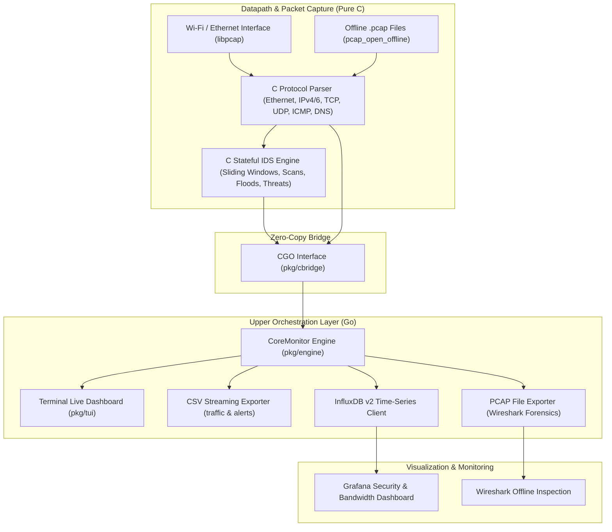

# CoreMonitor 🛡️

**CoreMonitor** is a high-performance Network Traffic Analyzer and Intrusion Detection System (IDS). It features a **pure C low-level datapath engine** for line-speed packet sniffing, protocol parsing, and stateful intrusion detection, paired with a **Go upper orchestration layer** for multi-format storage, real-time terminal UI, and InfluxDB/Grafana visualization.

---

## 🏗️ Architecture



---

## 🌟 Key Features

1. **High-Performance C Datapath Core (`c_core/`)**
   - Direct packet ingestion using `libpcap` with support for custom Berkeley Packet Filters (BPF).
   - Fast protocol decoding: Ethernet, ARP, IPv4, IPv6, TCP (flags bitmask decoding), UDP, ICMP, and DNS query domain parsing.
   - **TLS Client Hello SNI Extraction**: Parses the unencrypted Server Name Indication (SNI) extension from TLS handshakes directly on the wire, revealing visited domain names (e.g. `github.com`, `discord.com`) inside encrypted HTTPS traffic.
   - **Cleartext HTTP Dissection**: Zero-copy dissection of cleartext HTTP requests (methods: `GET`, `POST`, `PUT`, `DELETE`, etc.), request URIs, `Host`, and `User-Agent` headers.
   - Stateful IDS rules evaluated directly in C:
     - **SYN Port Scans**: Sliding window tracking distinct probed ports per host.
     - **Stealth Scans**: Flags Xmas (`FIN+PSH+URG`), Null (0 flags), and FIN scans.
     - **DoS / Floods**: TCP SYN flood and ICMP ping flood detection.
     - **Bandwidth Spikes**: Instantaneous byte rate threshold alerts.
     - **Suspicious Services**: Flags cleartext credentials (Telnet port 23, FTP port 21) and known attacker listener ports (Metasploit 4444, Back Orifice 31337).
     - **DNS Tunneling**: Identifies suspiciously long domain queries (> 60 characters).
     - **Threat Intelligence**: Immediate matching against blacklisted IP feeds with alert cooldown suppression.

2. **Active Defense: Intrusion Prevention System (IPS) (`pkg/ips/`)**
   - **Automated Firewall Jail**: Automatically neutralizes threats by executing Linux `iptables` / `nftables` DROP rules against offending hosts.
   - **Configurable Modes**:
     - `simulate`: Safe audit mode that logs and simulates defensive actions without modifying live firewall tables.
     - `block`: Active enforcement that drops all traffic from attackers.
   - **Timed Auto-Unban**: Configurable jail duration (e.g. 10 minutes) with automatic background expiration and unbanning.
   - **Built-in Whitelist**: Guarantees gateway, localhost (`127.0.0.1`), and management subnets are immune to lockout.
   - **Clean Teardown**: Automatically removes temporary DROP rules upon engine shutdown so your firewall tables remain clean.

3. **5-Tuple Bidirectional Flow Aggregator (`pkg/flow/`)**
   - **Canonical 5-Tuple Conversation Key**: Maps forward (`A -> B`) and reverse (`B -> A`) packets to unified bidirectional session objects.
   - **Granular Flow Telemetry**: Tracks initiator vs. responder packet counts, byte volumes, flow lifespan/duration, and state transitions (`ACTIVE`, `CLOSED` on TCP FIN/RST, `TIMED_OUT`).
   - **Application Association**: Correlates TLS SNI domains, HTTP requests (method, host, URI), and DNS query metadata with long-running flows.
   - **Configurable Idle & Active Timeouts**: Automated background janitor sweeps and flushes stale conversation sessions.

4. **Multi-Channel Webhook Alert Dispatcher (`pkg/webhook/`)**
   - **Non-Blocking Asynchronous Queue**: Dispatches alerts in the background via buffered worker pools without slowing packet capture or datapath throughput.
   - **Discord Rich Embeds**: Formatted alert cards with threat severity badges (Red for `CRITICAL`, Orange for `HIGH`), attacker location flags, victim endpoint, threat signatures, and active defense status.
   - **Slack & Telegram Integrations**: Structured Slack Block Kit messages and Telegram Markdown alerts.
   - **Alert Deduplication & Cooldown**: Throttles alert bursts (e.g. max 1 alert per attacker IP and threat type per 30 seconds) to prevent webhook rate-limit bans.

5. **Native Prometheus Metrics Exporter (`pkg/metrics/`)**
   - **Standard Prometheus Exposition Format (v0.0.4)**: Serves `/metrics` over an embedded HTTP server (default: `0.0.0.0:2112/metrics`).
   - **Zero-Dependency Lightweight Implementation**: Exposes counters and gauges without bloated dependencies:
     - `coremonitor_packets_total`: Counter of all processed packets.
     - `coremonitor_bytes_total`: Counter of cumulative network byte volume.
     - `coremonitor_protocol_packets_total{protocol="..."}`: Per-protocol packet breakdown.
     - `coremonitor_packets_per_second` & `coremonitor_bytes_per_second`: Live instantaneous throughput gauges.
     - `coremonitor_alerts_total{severity="...",alert_type="..."}`: Cumulative IDS threat counter.
     - `coremonitor_ips_banned_hosts`: Active jailed attacker hosts.
     - `coremonitor_active_flows` & `coremonitor_flows_total`: 5-tuple conversation flow telemetry.
   - Built-in `/healthz` health-check endpoint for Kubernetes liveness/readiness probes.

6. **Modern Go Upper Layer (`pkg/`, `cmd/`)**
   - High-throughput zero-copy CGO bridge.
   - **Multi-Format Storage**:
     - Standard `.pcap` files with automated time-based rotation.
     - Streaming CSV logs (`captures/traffic_*.csv` and `captures/alerts_*.csv`).
     - InfluxDB v2 line-protocol dispatcher with non-blocking resilience.
   - **GeoIP & Country Mapping**:
     - Fast zero-dependency offline CIDR-based resolver with memory caching.
     - Differentiates LAN / RFC1918 traffic (`🏠 LAN`) from external public hosts.
     - Maps public IPs to country codes, country names, organization/ASN, and regional indicator flag emojis (e.g. 🇺🇸, 🇩🇪, 🇮🇳, 🇬🇧, 🇫🇷, 🇯🇵).
     - Enriches terminal TUI, packet details, CSV logs, and InfluxDB/Grafana metrics.
   - **Interactive Charmbracelet Bubbletea TUI**: Modern 5-tab terminal dashboard featuring:
     - `Tab` / `1-5`: Switch views between **Overview Dashboard**, **Live Packets**, **Security Alerts**, **IPS Jails**, and **Flow Conversations**.
     - `/`: **Live BPF Filter Prompt**: Type Berkeley Packet Filters (e.g. `tcp and port 443`, `host 192.168.1.50`, `not broadcast`, or `clear`) to recompile and hot-reload `libpcap` on the fly without restarting.
     - `Space`: Instant **Pause / Resume** to inspect live packet bursts without losing your place.
     - `↑` / `↓`: Interactive row selection cursor.
     - `Enter`: Full packet, security alert, and bidirectional flow detail inspection modal.
     - `q` / `Ctrl+C`: Clean shutdown.

3. **Grafana & InfluxDB Visualization (`grafana/`)**
   - Pre-provisioned InfluxDB datasource and Grafana dashboard (`docker-compose.yml`).
   - Visual panels: throughput over time, protocol distribution donut chart, top talkers bar chart, DNS query logs, and live security events table.

4. **Python Attack & Traffic Simulation (`scripts/` via `uv`)**
   - Synthetic traffic generator using Scapy to simulate benign web flows alongside multi-vector attacks.

---

## 🚀 Quick Start

### 1. Build the Entire System

Requirements: `gcc`, `make`, `libpcap-dev`, `go` (>= 1.20).

```bash
git clone https://github.com/deepak-pandey2005/CoreMonitor.git
cd CoreMonitor

make all
```

This compiles:
- `c_core/libcmonitor.a` (C core library)
- `bin/coremonitor` (Go application binary)

### 2. Network Sniffing Permissions (Linux)

To capture packets on live interfaces without running everything as root:

```bash
sudo ./scripts/setup_permissions.sh
```

---

## 💻 Usage

### Live Network Capture & IDS

Start monitoring live traffic on your Wi-Fi interface (`wlan0`):

```bash
./bin/coremonitor live -i wlan0
```

To run in headless daemon mode (plain logging without the interactive TUI):
```bash
./bin/coremonitor live -i wlan0 --no-tui
```

Apply a custom BPF filter (e.g. monitor only HTTP/HTTPS traffic):
```bash
./bin/coremonitor live -i wlan0 -b "tcp port 80 or tcp port 443"
```

### Offline PCAP Forensics

Deeply inspect an existing `.pcap` capture file:

```bash
./bin/coremonitor pcap tests/fixtures/attack_sample.pcap --no-influx
```

### Synthetic Traffic & Attack Simulation

Generate synthetic benign traffic and attacks (SYN port scans, Xmas scans, Null scans, Telnet, Metasploit, DNS tunneling, ICMP floods) using `uv`:

```bash
uv sync
uv run scripts/simulate_traffic.py -o captures/sim_attack.pcap
./bin/coremonitor pcap captures/sim_attack.pcap --no-influx
```

---

## 📊 InfluxDB & Grafana Stack

Launch InfluxDB and Grafana with one command:

```bash
docker compose up -d
```

- **Grafana**: Open [http://localhost:3000](http://localhost:3000) (Login: `admin` / `admin`). The **CoreMonitor Network Security & Bandwidth Dashboard** is pre-loaded and ready.
- **InfluxDB**: [http://localhost:8086](http://localhost:8086) (Org: `coremonitor-org`, Bucket: `network_metrics`).

---

## 🧪 Testing

Run both the C unit tests and the Go integration tests:

```bash
make test
```

---

## 📄 License

MIT License. Designed and developed for open-source defensive network security and performance monitoring.
